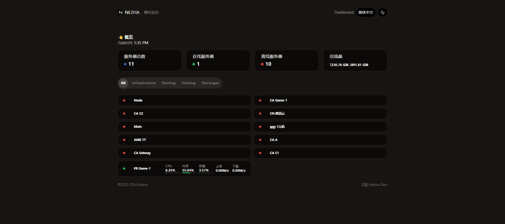
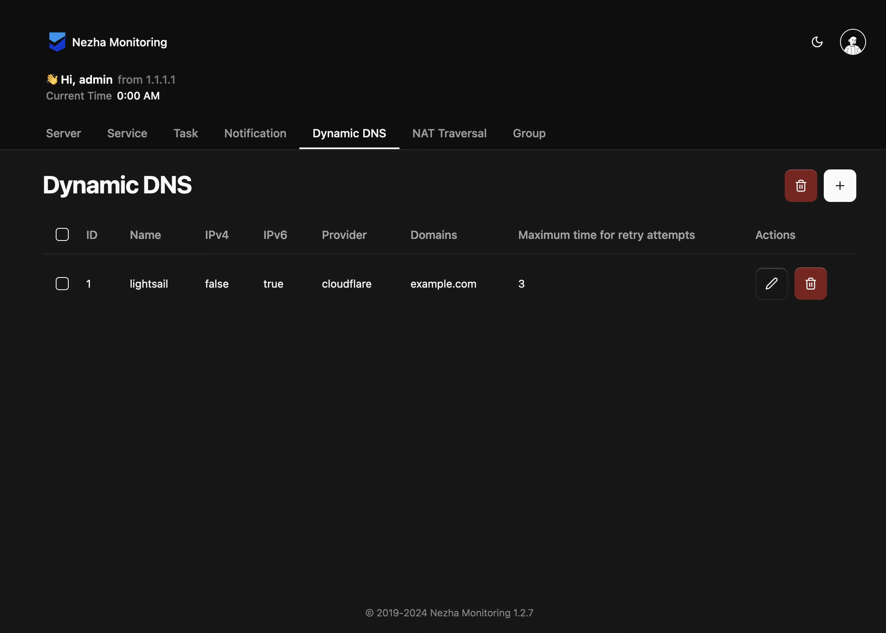

<div align="center">
  <br>
  
  <br>
  <small><i>LOGO designed by <a href="https://xio.ng" target="_blank">熊大</a> .</i></small>
  <br><br>
&nbsp;&nbsp;&nbsp;<a href="https://hosted.weblate.org/engage/nezha/"></a>
  <br>
  <br>
  <a href="https://trendshift.io/repositories/12344?utm_source=repository-badge&amp;utm_medium=badge&amp;utm_campaign=badge-repository-12344" target="_blank" rel="noopener noreferrer"></a>
  <br>
  <br>
  <p>:trollface: <b>Nezha Monitoring: Self-hostable, lightweight, servers and websites monitoring and O&M tool.</b></p>
  <p>Supports <b>monitoring</b> system status, HTTP (SSL certificate change, upcoming expiration, expired), TCP, Ping and supports <b>push alerts</b>, run scheduled tasks and <b>web terminal</b>.</p>
</div>

\>> Official Forum | 官方论坛: [有点意思](https://lajilao.com/c/nezha)<br>
\>> Telegram Channel: [哪吒监控（中文通知频道）](https://t.me/nezhanews)<br>

\>> [Use Cases | 我们的用户](https://www.google.com/search?q=%22%E5%93%AA%E5%90%92%E7%9B%91%E6%8E%A7+Nezha+Monitoring%22) (Google) <br>
<sub>\>> Telegram Group: [Nezha Monitoring Global (English Only)](https://t.me/nezhamonitoring_global), [哪吒监控（中文群组）](https://t.me/nezhamonitoring)</sub>

## Sponsors / 赞助商

> 🤝 Sponsorship slot available / 赞助位待认领

## User Guide

- [English](https://nezhahq.github.io/en_US/index.html)
- [中文文档](https://nezhahq.github.io/index.html)

## 数据库配置 | Database Configuration

哪吒监控支持多种数据库后端，包括 **SQLite**（默认）、**MySQL**、**PostgreSQL** 和 **SQL Server**。

### 配置优先级

**环境变量 > 配置文件 > 命令行参数**

### SQLite（默认）

无需配置，开箱即用：
```bash
./dashboard -db data/sqlite.db
```

### MySQL

**方式一：配置文件** (`data/config.yaml`)
```yaml
database:
  type: mysql
  host: localhost
  port: 3306
  username: nezha
  password: your_password
  dbname: nezha
```

**方式二：环境变量**（推荐用于 Docker/Kubernetes）
```bash
export NZ_DATABASE_TYPE=mysql
export NZ_DATABASE_HOST=localhost
export NZ_DATABASE_PORT=3306
export NZ_DATABASE_USERNAME=nezha
export NZ_DATABASE_PASSWORD=your_password
export NZ_DATABASE_DBNAME=nezha
```

### PostgreSQL

```yaml
database:
  type: postgres
  host: localhost
  port: 5432
  username: postgres
  password: your_password
  dbname: nezha
  sslmode: disable  # 可选: disable, require, verify-ca, verify-full
```

### SQL Server

```yaml
database:
  type: sqlserver
  host: localhost
  port: 1433
  username: sa
  password: your_password
  dbname: nezha
```

### 环境变量列表

| 环境变量 | 说明 | 示例 |
|---------|------|------|
| `NZ_DATABASE_TYPE` | 数据库类型 | `sqlite`, `mysql`, `postgres`, `sqlserver` |
| `NZ_DATABASE_HOST` | 数据库主机 | `localhost`, `db.example.com` |
| `NZ_DATABASE_PORT` | 数据库端口 | `3306`, `5432`, `1433` |
| `NZ_DATABASE_USERNAME` | 用户名 | `root`, `postgres`, `sa` |
| `NZ_DATABASE_PASSWORD` | 密码 | `your_password` |
| `NZ_DATABASE_DBNAME` | 数据库名 | `nezha` |
| `NZ_DATABASE_SSLMODE` | SSL 模式 (PostgreSQL) | `disable`, `require` |
| `NZ_DATABASE_PATH` | SQLite 文件路径 | `data/sqlite.db` |

## 安全加固 | Security Hardening

agent 以 root / SYSTEM 运行。面板一旦失守（弱口令、泄露的 JWT 或 API Token、面板漏洞），攻击者就能通过面板控制所有被监控的服务器。本 fork 增加了以下防护：

### 面板侧高危能力锁

在 `config.yaml` 中关闭不需要的能力。这些开关只能通过配置文件或环境变量设置，网页和 API 无法修改，因此即使面板账号被盗也无法重新打开：

```yaml
security:
  disable_command_execute: true   # 批量 / 计划任务执行命令、MCP exec
  disable_terminal: true          # WebSSH 终端
  disable_file_manager: true      # 文件管理、MCP 文件读写与传输
  disable_agent_config: true      # 远程查看 / 修改 agent 配置
  disable_server_transfer: true   # 服务器迁移
  disable_agent_upgrade: false    # 远程强制升级 agent
  disable_nat: true               # 内网穿透
```

环境变量写法去掉键名中的下划线，例如 `NZ_SECURITY_DISABLECOMMANDEXECUTE=true`。

### agent 侧（最终防线）

即使面板被完全攻破，agent 自己的开关也无法被面板远程改回。建议每台服务器的 agent 配置：

```yaml
disable_command_execute: true   # 拒绝命令、终端、文件管理、远程改配置
disable_nat: true               # 拒绝内网穿透
disable_force_update: true      # 拒绝面板强制升级
tls: true                       # 与面板之间加密传输
```

### 其他

- 空数据库初始化时不再使用 `admin/admin`，改为随机密码并打印在启动日志中；也可以用环境变量 `NZ_ADMIN_PASSWORD` 指定。
- 每次启动都会进行安全自检：弱口令、过短的密钥、过宽的配置文件权限（自动收紧为 0600）。同时列出全部用户、API Token、计划任务和内网穿透，便于发现异常。
- 面板只通过 HTTPS（或 HTTPS 反向代理）访问，最好再加 IP 白名单或 Cloudflare Access 等前置认证；使用 OAuth2 时务必设置 `dashboard_host`。

## Contributing

### Translation

<a href="https://hosted.weblate.org/engage/nezha/">

</a>

Is Nezha not in your language, or the translation is incorrect or incomplete? Get involved in the translations on [Hosted Weblate](https://hosted.weblate.org/engage/nezha/).

## Screenshots

| 用户前台 [@hamster1963](https://github.com/hamster1963) | 管理后台 [@nezhahq](https://github.com/nezhahq) |
|---|---|
|   |   |
| [hamster1963/nezha-dash](https://github.com/hamster1963/nezha-dash)  | [nezhahq/admin-frontend](https://github.com/nezhahq/admin-frontend)  |

add your theme to [service/singleton/frontend-templates.yaml](service/singleton/frontend-templates.yaml)

## Contributors

<!--GAMFC_DELIMITER--><a href="https://github.com/naiba" title="naiba"></a>
<a href="https://github.com/uubulb" title="UUBulb"></a>
<a href="https://github.com/AkkiaS7" title="Akkia"></a>
<a href="https://github.com/Erope" title="卖女孩的小火柴"></a>
<a href="https://github.com/nap0o" title="nap0o"></a>
<a href="https://github.com/dysf888" title="黑歌"></a>
<a href="https://github.com/xykt" title="xykt"></a>
<a href="https://github.com/MikoyChinese" title="MikoyChinese"></a>
<a href="https://github.com/weblate" title="Weblate (bot)"></a>
<a href="https://github.com/JackieSung4ev" title="JackieSung4ev"></a>
<a href="https://github.com/77-QiQi" title="77-QiQi"></a>
<a href="https://github.com/cantoblanco" title="Kris"></a>
<a href="https://github.com/lemoeo" title="Lemoe"></a>
<a href="https://github.com/spiritLHLS" title="spiritlhl"></a>
<a href="https://github.com/liuyanxi975" title="刘颜溪"></a>
<a href="https://github.com/CosmosZ-code" title="CosmosZ-code"></a>
<a href="https://github.com/lvgj-stack" title="Ko no dio"></a>
<a href="https://github.com/hhhkkk520" title="Kris"></a>
<a href="https://github.com/Mmx233" title="Mmx233"></a>
<a href="https://github.com/rootmelo92118" title="rootmelo92118"></a>
<a href="https://github.com/Moraxyc" title="Moraxyc Xu"></a>
<a href="https://github.com/hamster1963" title="仓鼠"></a>
<a href="https://github.com/1ridic" title="1ridic"></a>
<a href="https://github.com/zhucaidan" title="zhucaidan"></a>
<a href="https://github.com/iilemon" title="Sean"></a>
<a href="https://github.com/lyj0309" title="lyj"></a>
<a href="https://github.com/fscarmen" title="fscarmen"></a>
<a href="https://github.com/ch8o" title="no-name-now"></a>
<a href="https://github.com/MemoryShadow" title="JSker9"></a>
<a href="https://github.com/HsukqiLee" title="Hsukqi Lee"></a>
<a href="https://github.com/DarcJC" title="Darc Z."></a>
<a href="https://github.com/Creling" title="Creling"></a>
<a href="https://github.com/coreff" title="Core F"></a>
<a href="https://github.com/NikoCat233" title="NikoCat233"></a>
<a href="https://github.com/wellcoming" title="Coming Wel"></a>
<a href="https://github.com/acgpiano" title="Acgpiano"></a>
<a href="https://github.com/eya46" title="eya46"></a>
<a href="https://github.com/guoyongchang" title="guoyongchang"></a>
<a href="https://github.com/hiDandelion" title="霧島拓真"></a>
<a href="https://github.com/honeok" title="honeok"></a>
<a href="https://github.com/yuanweize" title="IYUANWEIZE"></a>
<a href="https://github.com/igophper" title="igophper"></a>
<a href="https://github.com/lvyaoting" title="lvyaoting"></a>
<a href="https://github.com/quanljh" title="quanljh"></a>
<a href="https://github.com/unclezs" title="unclezs"></a>
<a href="https://github.com/xvkong233" title="虚空"></a>
<a href="https://github.com/ysicing" title="缘生"></a>
<a href="https://github.com/yanhao98" title="严浩"></a>
<a href="https://github.com/arkylin" title="凌"></a>
<a href="https://github.com/yumusb" title="榆木"></a>
<a href="https://github.com/colour93" title="93"></a>
<a href="https://github.com/wwng2333" title=":D"></a>
<a href="https://github.com/Es-dese" title="Esdese"></a>
<a href="https://github.com/GreenTeodoro839" title="GreenTeodoro839"></a>
<a href="https://github.com/techotaku" title="Ian Li"></a>
<a href="https://github.com/KorenKrita" title="KorenKrita"></a>
<a href="https://github.com/funnyzak" title="Leon"></a>
<a href="https://github.com/MartijnLindeman" title="Martijn Lindeman"></a>
<a href="https://github.com/silver-ymz" title="Mingzhuo Yin"></a>
<a href="https://github.com/dreamingsleeping" title="Nanjing Hopefun Network Technology Co. Ltd."></a>
<a href="https://github.com/Septrum101" title="Spetrum"></a>
<a href="https://github.com/IamTaoChen" title="Tao Chen"></a>
<a href="https://github.com/nickfox-taterli" title="Tater Li"></a>
<a href="https://github.com/TomyJan" title="TomyJan"></a>
<a href="https://github.com/hmsjy2017" title="Tony"></a>
<a href="https://github.com/ace-consultoria" title="ace-consultoria"></a>
<a href="https://github.com/adminsama" title="adminsama"></a>
<a href="https://github.com/railzen" title="Chra"></a>
<a href="https://github.com/Mubelotix" title="Mubelotix"></a>
<a href="https://github.com/ryrenz" title="Ryrenz"></a>
<a href="https://github.com/Sam5440" title="Sam5440"></a>
<a href="https://github.com/zhdsmy" title="zhdsmy"></a><!--GAMFC_DELIMITER_END-->

## Special Thanks
- [IPInfo](https://ipinfo.io/) for providing an accurate GeoIP Database.

## Star History

[](https://star-history.dera.page/#nezhahq/nezha&Timeline)
